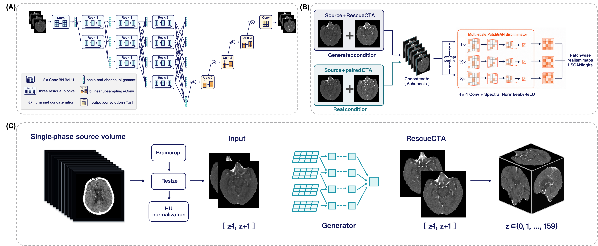

# RescueCTA

[](https://doi.org/10.3389/fneur.2026.1955596)
[](https://doi.org/10.3389/fneur.2026.1955596)
[](https://creativecommons.org/licenses/by-nc/4.0/)
[](https://www.python.org/)
[](https://pytorch.org/)

> :tada: **News (2026):** RescueCTA has been accepted for publication in
> [Frontiers in Neurology](https://doi.org/10.3389/fneur.2026.1955596) —
> *Generative enhancement of suboptimally opacified cerebral CT angiography
> for large-vessel occlusion detection: a multireader study*.

RescueCTA is a paired, supervised 2.5D conditional generative model for
vascular image enhancement after suboptimal arterial-phase CT angiography
(CTA). It generates a synthetic rescue CTA volume from a single
under-opacified acquisition for joint interpretation with the source images.

This repository contains the curated research implementation used in the
associated medical-imaging study: the generator, multiscale conditional
PatchGAN discriminator, training losses and schedules, exponential moving
average (EMA) checkpoint support, and NIfTI inference pipeline.

## Model overview



**Figure 2. RescueCTA architecture and inference workflow.** (A) The
hierarchical high-resolution generator maintains parallel multiresolution
feature streams with repeated cross-scale fusion. (B) A three-scale
conditional PatchGAN discriminator evaluates source-output and source-target
pairs. (C) During inference, adjacent axial sections form each 2.5D input;
generated sections are restored to the source geometry and assembled into a
three-dimensional rescue volume.

Key implementation details:

- **Input:** three consecutive axial sections, `[z-1, z, z+1]`, represented as
  three channels.
- **Generator:** six hierarchical stages with parallel high-resolution
  branches and repeated cross-scale fusion.
- **Discriminator:** three-scale conditional PatchGAN with spectral
  normalization.
- **Objective:** L1 reconstruction, least-squares GAN, VGG-19 perceptual,
  discriminator feature-matching, edge, and Laplacian losses.
- **Final training configuration:** 200 epochs with EMA generator weights
  (`decay=0.999`).

## Repository structure

| Path | Description |
| --- | --- |
| `models/` | RescueCTA generator and multiscale discriminator |
| `losses/` | Reconstruction, adversarial, perceptual, feature, edge, and Laplacian losses |
| `engine/` | Training and validation loop |
| `data/` | Paired 2.5D training dataset and preprocessing |
| `configs/rescuecta_paper.yaml` | Architecture, optimizer, loss schedule, EMA policy, and training settings used for the manuscript model |
| `train.py` | Single-GPU and distributed training entry point |
| `infer_nifti.py` | Three-dimensional NIfTI inference with EMA weights by default |
| `docs/data_format.md` | Accepted training arrays and inference-volume format |
| `tests/` | Model-shape, legacy-key, and EMA-selection tests |

## Intended use

RescueCTA is research software. Generated images are supplemental and must be
reviewed together with the source images. They are not a diagnostic reference
standard and must not be used as the sole basis for treatment decisions.

The model targets arterial under-opacification caused by acquisition-timing
failure. It was not designed to repair incomplete anatomic coverage, severe
motion, scanner interruption, or unrelated acquisition failures.

## Installation

```bash
conda env create -f environment.yaml
conda activate rescuecta
```

## Data format

Training accepts paired `.npy` or `.dcm` files with identical filenames:

```text
dataset/
├── source/   # under-opacified 2.5D inputs
└── target/   # spatially registered paired CTA targets
```

Arrays must be in Hounsfield units and may contain a single section or a
three-channel 2.5D stack. Registration of source and target volumes is expected
to be completed before training and is outside this repository. See
[the data-format documentation](docs/data_format.md) for accepted layouts and
normalization details.

## Training

Edit the portable data paths in `configs/rescuecta_paper.yaml`, then run:

```bash
python train.py \
  --config configs/rescuecta_paper.yaml \
  --gpus 0,1,2,3
```

Resume from the latest generator and discriminator checkpoints with:

```bash
python train.py \
  --config configs/rescuecta_paper.yaml \
  --gpus 0,1,2,3 \
  --resume
```

The manuscript configuration records the architecture, optimizer, progressive
loss schedule, EMA policy, random seed, and epoch count. Checkpoints produced
by the training loop contain both raw generator weights (`G_state_dict`) and
EMA generator weights (`G_ema_state_dict`).

## NIfTI inference

Place `.nii` or `.nii.gz` input volumes in one directory and run:

```bash
python infer_nifti.py \
  --config configs/rescuecta_paper.yaml \
  --data_root /path/to/input_nifti \
  --checkpoint /path/to/net_G_ep200.pth \
  --output_dir /path/to/rescuecta_output
```

EMA weights are selected by default because they were used for the final
manuscript model. Use `--weights raw` only for an explicitly planned
raw-versus-EMA comparison.

The default `--channel_strategy mean` reproduces the historical inference
pipeline by averaging the three output channels. The optional
`--channel_strategy center` keeps the central output channel. Do not mix these
strategies within one evaluation.

The trained checkpoint is not distributed in this repository.

## Testing

```bash
python -m compileall .
pytest -q
```

## Privacy and data availability

No patient data, DICOM metadata, institutional filesystem paths, model
checkpoints, or training outputs are included. Access to study data and trained
weights is subject to institutional approvals and the data-sharing statement
of the associated manuscript.

<sub><em>Note on reported performance. All quantitative results in the
manuscript were obtained on the authors' internal datasets, preprocessing,
and hardware. Results obtained with this code on other data or equipment
are expected to differ, and identical metrics from third-party
reproduction are neither guaranteed nor implied.</em></sub>

## Citation

If you use this repository in your research, please cite the associated
paper:

```bibtex
@article{tu2026rescuecta,
  author  = {Tu, Y. and Wang, M. and Sun, Z. and Zeng, Y. and Li, Y. and
             Tang, Y. and Yang, Y. and Cao, Z. and Hu, S. and Wang, D. and
             Li, Y.},
  title   = {Generative enhancement of suboptimally opacified cerebral
             {CT} angiography for large-vessel occlusion detection:
             a multireader study},
  journal = {Frontiers in Neurology},
  year    = {2026},
  volume  = {17},
  doi     = {10.3389/fneur.2026.1955596}
}
```

This code is provided as a curated research artifact of the published
study. Reuse, retraining, or re-evaluation outside the settings of the
original study is at the discretion and responsibility of the user (see
the performance note above and the license below).

## License

This repository is licensed under the
[Creative Commons Attribution-NonCommercial 4.0 International License
(CC BY-NC 4.0)](https://creativecommons.org/licenses/by-nc/4.0/); the full
license text is provided in [LICENSE](LICENSE). Commercial use requires
prior written permission from the authors.
